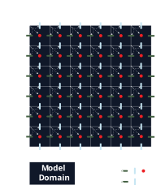
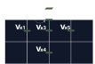

# Pseudo Transient Stokes Solvers
## Numerical Justification
The standard incompressible steady-state mass and momentum conservation equations (elliptical) form a saddle point problem with pressure acting as a
Lagrangian multiplier. Such systems have the following properties:
* Indefinite - The matrix eignevalues are +ve and -ve mixed, with no simple minimum,
* The system necessitates 'LBB' or 'Inf-Sup' criterion,
* Poor conditioning - Significant difference in magnitudes between velocity and pressure.

The pseudo-transient approach introduces artificial time derivatives to these
conservation equations which embeds regularisation terms into the system. This
then provides a pressure block diagonal dominance, suppressing unphysical
behaviours and significantly improves the condition number.

## Physics Formulation
We begin with the standard steady-state conservation equations for incompressibile
and inertialess flow:

*Conservation of mass*,
```math
\nabla\cdot\underline{\mathbf{v}}=0
```
*Conservation of momentum*,
```math
-\nabla P + \nabla\cdot\underline{\mathbf{\sigma'}} =
-\rho g\underline{\mathbf{e}}_y,
```
With Newton's consitutive law:
```math
-\nabla P + \nabla\cdot(2\underline{\mathbf{\dot{\varepsilon}}}'\eta) =
-\rho g\underline{\mathbf{e}}_y.
```
In the pseudo-transient approach, we add artificial time derivatives, ``\partial\tau``, that recover the original conservation equations as they tend to zero.
This transforms the equations from elliptical to parabolic, through a new equation of state (EOS) compressibility term, ``\beta\frac{\partial P}{\partial\tau}``, in
the conservation of mass, and an inertial term,
``\rho^*\frac{\partial\underline{\mathbf{v}}}{\partial\tau}``, in the
conservation of momentum. Here ``\beta`` and ``\rho^*`` are the artifical (non-physical)
compressibility and density respectively.

*Conservation of mass*,
```math
\beta\frac{\partial P}{\partial\tau}+\nabla\cdot\underline{\mathbf{v}}=0
```
*Conservation of momentum*,
```math
-\nabla P + \nabla\cdot(2\underline{\mathbf{\dot{\varepsilon}}}'\eta) -
\rho^*\frac{\partial\underline{\mathbf{v}}}{\partial\tau} =
-\rho g\underline{\mathbf{e}}_y.
```
Assuming incompressibility, ``\underline{\mathbf{\dot{\varepsilon}}}' = \underline{\mathbf{\dot{\varepsilon}}}``,
```math
-\nabla P + \nabla\cdot((\nabla\mathbf{v} + (\nabla\mathbf{v})^T)\eta) -
\rho^*\frac{\partial\underline{\mathbf{v}}}{\partial\tau} =
-\rho g\underline{\mathbf{e}}_y,
```
For constant ``\eta``,
```math
\frac{\partial\underline{\mathbf{v}}}{\partial\tau} = \frac{1}{\rho^*}(
-\nabla P + \eta\nabla^2\mathbf{v} + \eta\nabla(\nabla\cdot\mathbf{v})
+\rho g\underline{\mathbf{e}}_y),
```
We may then derive hyperbolic equations which are governed by the CFL stability condition, such that the pseudo-time step (``\Delta\tau``) is directly
proportional to the spatial resolution (``\Delta x``). This is advantageous as a typical parabolic systems has ``\Delta t \propto (\Delta x)^2``, meaning a doubling in the resolution requires quartering the time step.
This hyperbolic equation can be found by taking the pseudo-time derivative of the continuity equation and substituting the conservation of momentum equation,

*``\frac{\partial}{\partial\tau}``(Conservation of mass)*,
```math
\frac{\partial^2 P}{\partial\tau^2} = -\frac{1}{\beta}\nabla\cdot(\frac{\partial \underline{\mathbf{v}}}{\partial\tau}),
```
*Substitute conservation of momentum*,
```math
\frac{\partial^2 P}{\partial\tau^2} = -\frac{1}{\beta}\nabla\cdot(\frac{1}{\rho^*}(
-\nabla P + \eta\nabla^2\mathbf{v} + \eta\nabla(\nabla\cdot\mathbf{v})
+\rho g\underline{\mathbf{e}}_y)
),
```
*Expanding,*
```math
\frac{\partial^2 P}{\partial\tau^2} = \underbrace{\frac{1}{\beta\rho^*}\nabla^2P}_{\text{Classic Wave Equation}}
- \underbrace{\frac{1}{\beta\rho^*}\nabla\cdot(\rho g\underline{\mathbf{e}}_y)}_{\text{Buoyancy Source}} - \underbrace{\frac{\eta}{\beta\rho^*}
    2\nabla^2(\nabla\cdot\mathbf{v})}_{\text{Viscous Damping}}
,
```
*Substituting compressibility,*
```math
\frac{\partial^2 P}{\partial\tau^2} = \underbrace{\frac{1}{\beta\rho^*}\nabla^2P}_{\text{Classic Wave Equation}}
- \underbrace{\frac{1}{\beta\rho^*}\nabla\cdot(\rho g\underline{\mathbf{e}}_y)}_{\text{Buoyancy Source}} - \underbrace{\frac{\eta}{\beta\rho^*}
    2\nabla^2(-\beta\frac{\partial P}{\partial\tau})}_{\text{Viscous Damping}}
,
```
*Damped Wave Equation,*
```math
\frac{\partial^2 P}{\partial\tau^2} = \underbrace{\frac{1}{\beta\rho^*}\nabla^2P}_{\text{Classic Wave Equation}}
+\underbrace{\frac{\eta}{\rho^*}
    2\nabla^2(\frac{\partial P}{\partial\tau})}_{\text{Viscous Damping}}
,
```
By combining these conservation equations we form a hyperbolic equation, with a
characteristic wave speed of ``c^2 = \frac{1}{\beta\cdot\rho^*}``.

## Dispersion Analysis
A critical feature of the pseudo-transient method is finding terms for ``\beta``, ``\rho^*`` and ``\Delta\tau``, which both stabilises the system and provides rapid numerical convergence.

Analysing the system, we may substitute a Fourier ansatz, ``P(\underline{\mathbf{x}},\tau) = \hat{P}(\tau)e^{i\underline{\mathbf{k}}\cdot\underline{\mathbf{x}}}``, into the damped wave equation,

```math
\hat{P}(\tau)'' + \frac{2\eta\underline{\mathbf{k}}^2}{\rho^*}\hat{P}(\tau)' +
\frac{\underline{\mathbf{k}}^2}{\beta\rho^*}\hat{P}(\tau) = 0,
```
for ``\underline{\mathbf{k}} = k_x\underline{\mathbf{i}} + k_y \underline{\mathbf{j}}``. By substituting ``\hat{P}(\tau)=e^{\gamma\tau}`` into the linear homogeneous ordinary differential equation, we find root solutions of the form

```math
\gamma = -\frac{\eta\underline{\mathbf{k}}^2}{\rho^*} \pm \sqrt{\frac{\eta^2\underline{\mathbf{k}}^4}{\rho^{*2}}-\frac{\underline{\mathbf{k}}^2}{\beta\rho^*}}.
```
where we seek the minimum real root solutions the exponential decay rate, ``\gamma``.
In the first case, critical dampening may be obtained when the discriminant, ``D``, is zero,

```math
D = \frac{\eta^2\underline{\mathbf{k}}^4}{\rho^{*2}}-\frac{\underline{\mathbf{k}}^2}{\beta\rho^*} = 0,
```
```math
\therefore \frac{\eta^2\underline{\mathbf{k}}^2}{\rho^{*2}} = c^2,
```
substituting the wavespeed relation ``c^2 = \frac{1}{\beta\cdot\rho^*}``. If ``D>0``, then we obtain two roots for ``\gamma``,

```math
\gamma_1 = -\frac{\eta\underline{\mathbf{k}}^2}{\rho^*} + \sqrt{D},
```

```math
\gamma_2 = -\frac{\eta\underline{\mathbf{k}}^2}{\rho^*} - \sqrt{D}.
```
For ``D > 0``, both roots are negative and ``\gamma_2 < \gamma_1``. The ``\gamma_2`` mode decays faster, but a general solution contains both modes, whereby its long-time convergence is governed by the slower-decaying ``\gamma_1`` mode.

### Parameter Estimation
In the numerical setup, we seek parameters which will attenuate a given wave over the domain length, ``L_c``, for ``L_c =\operatorname{max}(Width, Height)``.


As the numerical scheme below combines explicit with semi-implicit formulations, the pseudo-timestep, ``\Delta\tau``, is limited by the CFL condition,
```math
c\Delta\tau = \operatorname{CFL}\frac{\Delta h}{\sqrt{n}},
```
where ``n`` is the number of spatial dimensions. As such, the code choses a fixed arbitrary ``c`` and then derives ``\Delta\tau`` from the CFL condition,
```math
\Delta\tau = \operatorname{CFL}\frac{\Delta h}{c\sqrt{n}},
```

From the Nyquist-Shannon sampling theorem, ``\lambda_{min} = 2\Delta h``, we can relate the characteristic wavenumber, ``k_c``, to the characteristic gridspacing, ``\Delta h`` by,

```math
||\underline{\mathbf{k}}|| = k_c=\frac{2\pi}{\lambda} = \frac{\pi}{\Delta h}.
```

Following the critical dampening equation,

```math
\frac{\eta^2 \underline{\mathbf{k}}^2}{\rho^{*2}} = \frac{\eta^2\pi^2}{\rho^{*2}\Delta h^2} = c^2,
```

Which can be reduced when all parameters are positive to,
```math
\rho^* = \frac{\eta\pi}{c\Delta h},
```
and
```math
\beta = \frac{1}{\rho^*c^2}
```

### Discretised Updates and Convergence
The explicit velocity update from the modified momentum equation is
```math
\underline{\mathbf{v}}^{l+1} = \underline{\mathbf{v}}^{l} + \frac{\Delta\tau}{\rho^*}\left(
-\nabla P^{l} + \eta\nabla^2\underline{\mathbf{v}}^{l} - \underline{\mathbf{f}}\right),
```
for the current pseudo-transient iteration, ``l``. The pressure update from the modified continuity equation then uses the updated velocities from the momentum equation via

```math
P^{l+1} = P^{l} - \frac{\Delta\tau}{\beta}\nabla\cdot\underline{\mathbf{v}}^{l+1}.
```
The pseudo-transient approach drives solutions to the steady-state as the pseudo timesteps tend to zero. As such, convergence is evaluated by the change in parameters across a pseudo timestep, made relative to the magnitude of the overall driving forcing ``f_{max}``. These residuals are determined by,

```math
r_{velocity} = \frac{\left\|\underline{\mathbf{v}}^{l+1}-\underline{\mathbf{v}}^{l}\right\|_\infty\rho^*}{\Delta\tau f_{max}},\qquad
r_{pressure} = \frac{\left\|P^{l+1}-P^{l}\right\|_\infty\beta}{\Delta\tau f_{max}\Delta h},
```
where an arbitrary tolerance, ``\max(10^{-6}, 1000\epsilon)``, is pre-set given a machine epsilon, ``\epsilon``, of the floating point number of the system, relating the differences in precision between Float32 and Float64. The solver further provides a warning if the maximum number of iterations is reached without convergence.

See [Alkhimenkov and Podladchikov (2025)](@ref "References") for the accelerated pseudo-transient method.

## Model Setup
Using the pseudo transient approach, the staggered-finite-difference formulation
from the monolithic approach is modified to eliminate ghost nodes, and the
requirements for global indexing are relaxed. As such, the array sizes for V_x,
V_y, and P are not equal, and additional boundary vectors are deployed (see
[Boundary Conditions](@ref "Boundary Conditions")).



## Boundary Conditions
The implemented staggered-finite-difference scheme affords collated boundary
nodes on Vx and Vy, but not for all boundaries. As such, from boundary condition
functions, the scheme implements the respective boundary conditions implicitly.

X-Stokes boundary condition layout


## References
Alkhimenkov, Y. and Podladchikov, Y.Y., 2025. Accelerated pseudo-transient method for elastic, viscoelastic, and coupled hydromechanical problems with applications. Geoscientific Model Development, 18(2), pp.563-583.